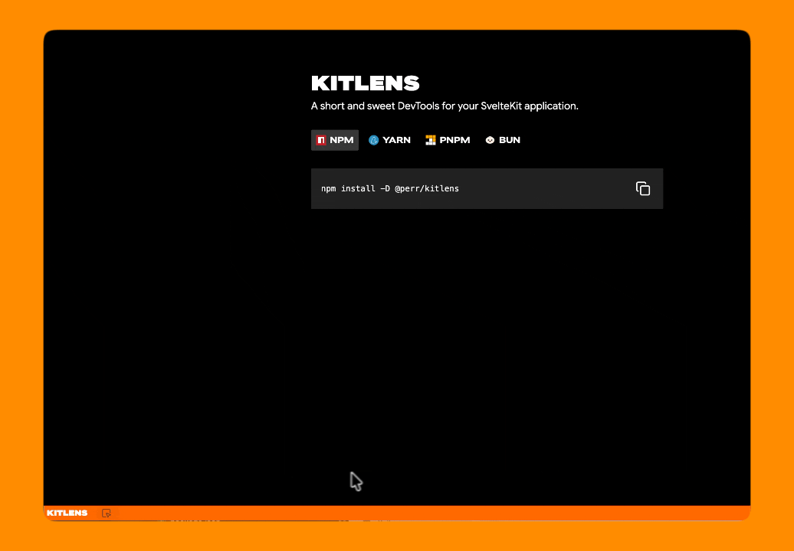

# KitLens
A short and sweet DevTools for your SvelteKit application.



## Quick Start

```sh
# npm
npm install -D @perr/kitlens

# yarn
yarn add -D @perr/kitlens

# pnpm
pnpm add -D @perr/kitlens

# bun
bun add -d @perr/kitlens
```

```ts
// vite.config.ts
import { defineConfig } from 'vite';
import { kitlens } from "@perr/kitlens";

export default defineConfig({
    plugins: [kitlens()],
});
```

## Local Development

```sh
# Clone the repository
git clone https://github.com/iluvicecream/kitlens.git
cd kitlens

# Install dependencies
bun install

# Start the development server
bun run dev
```

## How it works

The vite plugin inject a toolbar into the web page the toolbar uses svelte metadata info `__svelte_meta` that contain source file path and line number to open the file in your editor.

## Acknowledgements

This project is inspired by [Agentation](https://agentation.com/).